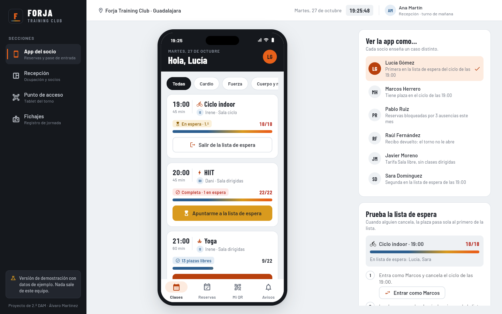
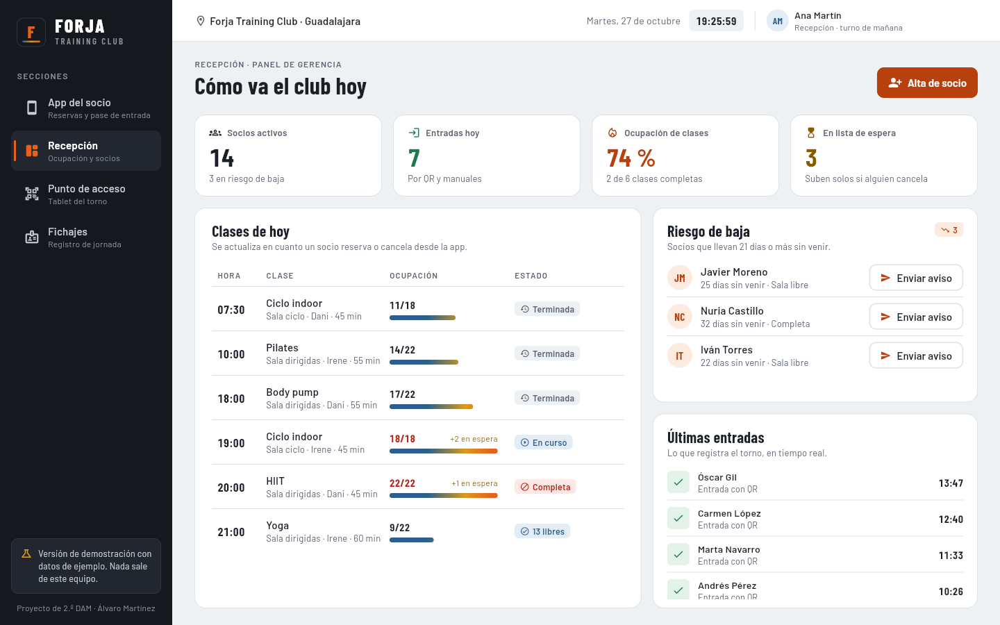
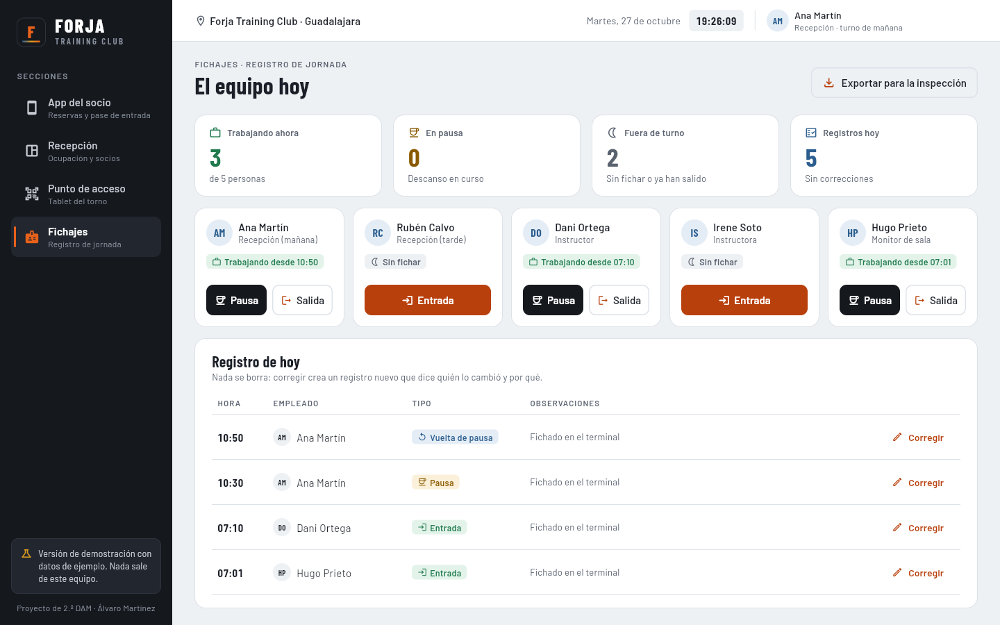
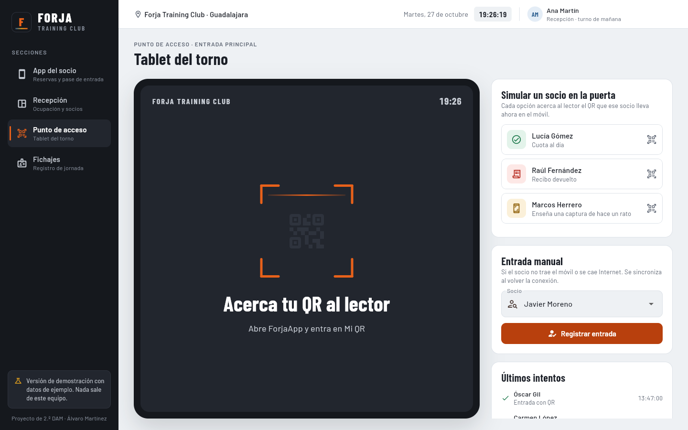
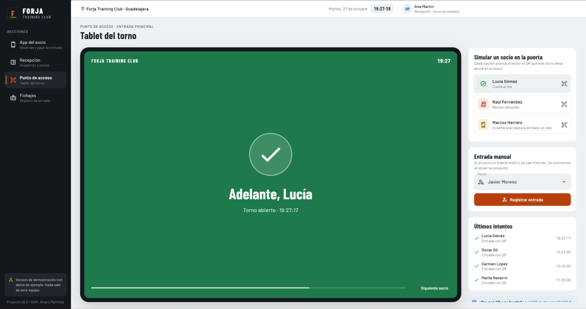
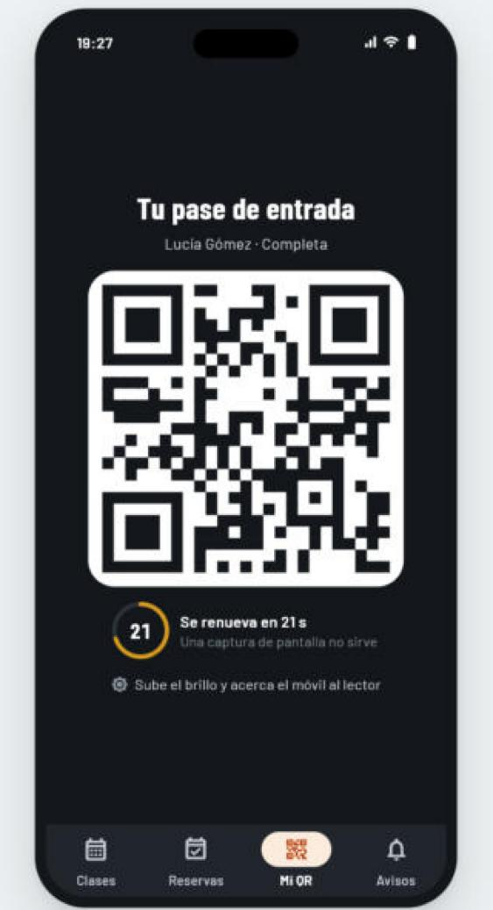

# ForjaApp · demo

Demo de **ForjaApp**, el proyecto de 2.º de DAM (IES Brianda de Mendoza) para **Forja Training Club**, un gimnasio independiente de Guadalajara (empresa ficticia).

La idea de negocio: sustituir el WhatsApp, el Excel, el PC de las tarjetas y la hoja de firmas por un sistema sencillo de **reservas de clases, control de accesos con QR y fichajes del personal**.



## Pruébala

| | Enlace |
|---|---|
| **Servidor del gimnasio** (Windows, primero esto) | [ForjaApp-Servidor-Setup.exe](https://github.com/martinezmendezalv-hue/forjaapp-demo/releases/download/demo/ForjaApp-Servidor-Setup.exe) · [portable](https://github.com/martinezmendezalv-hue/forjaapp-demo/releases/download/demo/ForjaApp-Servidor-portable.zip) |
| **En el navegador** (sin instalar nada) | **https://martinezmendezalv-hue.github.io/forjaapp-demo/** |
| **Windows: instalador** | [ForjaApp-Demo-Setup.exe](https://github.com/martinezmendezalv-hue/forjaapp-demo/releases/download/demo/ForjaApp-Demo-Setup.exe) |
| **Windows: portable** (sin instalar) | [ForjaApp-Demo-portable.zip](https://github.com/martinezmendezalv-hue/forjaapp-demo/releases/download/demo/ForjaApp-Demo-portable.zip) |
| **Android** (APK, sin Google Play) | [ForjaApp-Demo.apk](https://github.com/martinezmendezalv-hue/forjaapp-demo/releases/download/demo/ForjaApp-Demo.apk) |
| Todas las descargas | [Releases → demo](https://github.com/martinezmendezalv-hue/forjaapp-demo/releases/tag/demo) |

> [!WARNING]
> **Windows SmartScreen** avisará de que la aplicación es de un editor desconocido, porque el `.exe` no está firmado digitalmente (un certificado cuesta dinero y esto es un proyecto de clase).
> Pulsa **Más información → Ejecutar de todas formas**. El instalador no pide permisos de administrador.

Para la versión portable: descomprime el zip y abre `forja_app_demo.exe`.

> [!NOTE]
> **Android:** abre el enlace del APK desde el móvil, descárgalo y tócalo para instalarlo. Android pedirá permitir la instalación de apps de origen desconocido para el navegador o el gestor de archivos: es normal, porque la app no está en Google Play (subirla allí cuesta dinero). No hace falta cuenta ni pago.
> En **iPhone** usa la versión web: funciona igual, cámara incluida.

Las cuentas, los roles, los fichajes y los mensajes se guardan en **ForjaApp Servidor**, una app de Windows con su base de datos SQLite que corre en el PC del gimnasio. Las clases y reservas de la *App del socio* siguen siendo datos de ejemplo de **hoy**.

## El servidor y las cuentas

1. Instala **ForjaApp-Servidor-Setup.exe** en el PC del gimnasio y ábrelo. La primera vez Windows pregunta por el cortafuegos: marca **redes privadas**. La ventana enseña la dirección (por ejemplo `http://192.168.1.40:8080`) y un QR para conectar el móvil. La base de datos queda en `%APPDATA%\ForjaApp Servidor\forja.db`.
2. **Web:** abre esa dirección en cualquier navegador de la wifi; el servidor sirve la app web.
3. **Windows y Android:** en la pantalla de inicio de sesión toca **Servidor → Cambiar** y escribe la dirección (en Android también puedes **escanear el QR** de la ventana del servidor). Si la app de Windows está en el mismo PC, ya apunta a `localhost:8080`.

**Iniciar sesión no es lo mismo que registrarse**: quien no tiene cuenta no puede entrar. Las dos pantallas piden un **captcha de letras y números** y tienen el **ojo** para ver la contraseña; el registro pide repetirla y **aceptar las condiciones**.

| Rol | Cómo se crea | Qué ve |
|---|---|---|
| **Gerencia** | Ya existe: `martinez.mendez.alv@gmail.com` | Todo. Es la única cuenta que **ve y modifica los fichajes**, abre cuentas de trabajadores y lee los mensajes de *Contacto*. |
| **Trabajador** | Solo la abre gerencia en *Usuarios* | Recepción, punto de acceso, **solo sus fichajes y sin poder cambiarlos**, planes y contacto. |
| **Socio** | Se registra él mismo | Al registrarse le **saltan los planes** (Comfort, Premium y Ultimate, como los de Basic-Fit). Ve su pase QR real, los planes para **suscribirse** y *Contacto*, que llega a gerencia. |

El rol lo decide siempre el servidor: registrarse da rol de socio aunque alguien manipule la petición, y cada ruta de la API comprueba los permisos.

> [!IMPORTANT]
> La contraseña de gerencia es la que se pidió para la demo y es débil. Cámbiala en el menú de la cuenta → **Cambiar contraseña** antes de usarla con datos reales.

**Seguridad** (revisada con el plugin ECC): contraseñas con PBKDF2-SHA256 (600 000 iteraciones y sal), sesiones con token aleatorio guardado como hash y caducidad de 12 h, bloqueo tras 5 intentos fallidos por correo y equipo, captcha de un solo uso, límites por IP y un tope de trabajos pesados para que no tumben el PC. Además, consultas SQL parametrizadas y fichajes que la propia base de datos no deja modificar ni borrar (las correcciones son registros nuevos, una por fichaje). El pase QR va firmado con un secreto de cada socio y **solo abre una vez**. La API solo admite orígenes web conocidos (CORS) y envía cabeceras de seguridad con CSP; el CSV va protegido contra fórmulas. Va por HTTP dentro de la wifi del gimnasio: úsala en una red de confianza.

## Cómo enseñarla al público

La demo más vistosa usa **dos dispositivos**: uno hace de **móvil del socio** y otro de **tablet del torno**.

1. **Móvil del socio** (el APK o la web en un móvil): regístrate como socio, elige un plan y abre **Mi pase**. También puedes entrar como gerencia y, en *App del socio*, elegir a **Lucía Gómez** y abrir **Mi QR**. El código cambia cada **5 segundos** y la cuenta atrás lo muestra.
2. **Tablet del torno** (el `.exe` en un portátil con webcam, o el APK o la web en otro móvil), con una cuenta de gerencia o de trabajador: abre **Punto de acceso** y pulsa **Escanear con la cámara**. Los pases de socios con cuenta los valida el servidor.
3. Acerca el QR del primer móvil a la cámara: la pantalla se pone **verde** («Adelante, Lucía») y la entrada aparece en *Recepción → Últimas entradas*.
4. Repite con **Raúl Fernández**: sale en **rojo** porque tiene un recibo pendiente.
5. Haz una **captura de pantalla** del QR de Lucía, espera 10 segundos y enséñasela a la cámara: sale **«Código caducado»**. Ese es el motivo de que el código cambie cada 5 segundos.

Para que el lector acepte los códigos, la **hora de los dos dispositivos debe coincidir** (en Windows: *Configuración → Hora e idioma → Fecha y hora → Sincronizar ahora*). Los móviles ya la sincronizan solos.

Con **un solo dispositivo** también se puede: los botones de *Simular un socio en la puerta* (en el móvil, el botón **Simular**) hacen lo mismo sin cámara. Y la prueba de la lista de espera de la sección siguiente no necesita nada más.

## Las cuatro pantallas

| | |
|---|---|
|  |  |
| **Recepción**: ocupación de las clases, socios en riesgo de baja, últimas entradas y alta de socio. | **Fichajes**: entrada, pausa y salida del personal, correcciones que no borran el original y exportación CSV para la inspección. |
|  |  |
| **Punto de acceso**: la tablet del torno en reposo… | …y cuando el QR es válido. En rojo si la cuota está pendiente, en ámbar si el QR es una captura antigua. |

<p align="center"></p>

**App del socio** (dentro de un marco de móvil en el ordenador, a pantalla completa en el teléfono): clases de hoy con monitor, plazas y estado, reservas, lista de espera con ascenso automático, avisos y el **pase QR a pantalla completa que cambia cada 5 segundos**.

**Punto de acceso con cámara:** en el móvil, en la web y en Windows el botón *Escanear con la cámara* abre la cámara y lee el QR del socio. En Android, iPhone y la web usa `mobile_scanner`; en Windows hace fotos con la webcam y las lee con `zxing2`.

### Prueba recomendada

1. En *App del socio*, pulsa **Entrar como Marcos** y cancela su ciclo de las 19:00.
2. La plaza pasa sola a **Lucía Gómez**, la primera de la lista de espera.
3. Vuelve a Lucía y abre **Avisos**: tiene la plaza confirmada.

Otros casos: **Pablo Ruiz** no puede reservar (3 ausencias este mes), **Raúl Fernández** tiene el recibo devuelto y el torno no le abre, **Javier Moreno** tiene tarifa de sala sin clases dirigidas.

En la web se puede abrir cada sección directamente: [`?seccion=recepcion`](https://martinezmendezalv-hue.github.io/forjaapp-demo/?seccion=recepcion), [`?seccion=acceso`](https://martinezmendezalv-hue.github.io/forjaapp-demo/?seccion=acceso), [`?seccion=fichajes`](https://martinezmendezalv-hue.github.io/forjaapp-demo/?seccion=fichajes).

## Diseño

- **Identidad «acero templado»**: los colores del temple del acero (azul frío, paja y ascua) son también los estados de la app. La barra de ocupación de cada clase «se calienta» de azul a ascua según se llena.
- **Tipografía**: Barlow Condensed para titulares y cifras, Barlow para el texto. Van empaquetadas en `assets/fonts` (licencia SIL OFL).
- **Accesibilidad**: contraste AA en todo el texto, los estados siempre llevan icono además de color, objetivos táctiles de 44 px y etiquetas para lector de pantalla en tarjetas, QR e indicadores.
- Los tokens (colores, espaciado, radios, tipografía, animación) y los componentes compartidos están en `lib/theme.dart`.

## Cómo está hecha

- **Flutter 3.27** (Dart), el mismo framework que usaría la app real del socio en Android e iOS.
- El paquete `qr_flutter` dibuja el QR; `mobile_scanner`, `camera_windows` y `zxing2` lo leen con la cámara.
- **GitHub Actions** (`.github/workflows/windows.yml`) compila en cada cambio la versión de Windows con su instalador de **Inno Setup**, el **APK de Android** y la versión web. Los dos primeros se publican en la release `demo` y la web en **GitHub Pages**.

- **ForjaApp Servidor** (`servidor/`): app de escritorio Flutter con una API REST hecha con `shelf` y base de datos SQLite (`sqlite3`). También se puede arrancar sin ventana: `dart run bin/servidor.dart [--puerto 8080] [--bd forja.db] [--web ../build/web]`. Sus pruebas (`servidor/test/api_test.dart`) cubren login, registro, roles, captcha, bloqueos, fichajes, CSV, pase QR y CORS.

Las clases y reservas de la demo viven en memoria (`lib/data/store.dart`).

## Compilar en tu PC

Necesitas Flutter 3.27; para Windows, Visual Studio 2022 con «Desarrollo para el escritorio con C++» y el **Modo de desarrollador** de Windows activado (los plugins de cámara lo necesitan); para Android, el SDK de Android y un JDK 17.

```
flutter create --platforms=windows --org es.forja --project-name forja_app_demo .
flutter test
flutter run -d windows
```

Para Android: `flutter build apk --release`. Para la web: `flutter run -d chrome`.

Servidor: `cd servidor`, `flutter test` (en Windows necesita `sqlite3.dll` junto al proyecto) y `flutter run -d windows`.

---
Álvaro Martínez · Módulo de Proyecto · 2.º DAM · curso 2026/27
